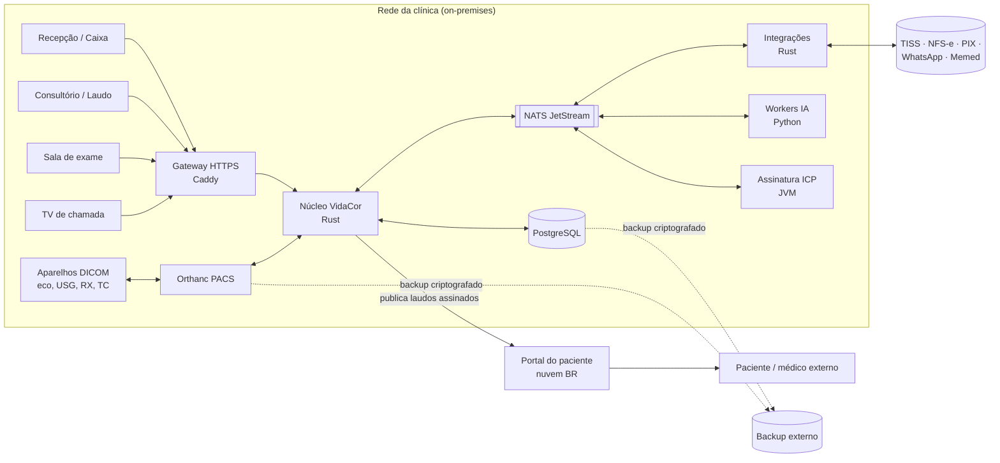

# 11 · Arquitetura e infraestrutura

> **Status:** proposta para revisão do time (v0.1, nov/2026).
> **Substitui** a [07 · Arquitetura proposta](07-arquitetura-proposta.md), que
> partia da suíte Clinica em .NET. As decisões individuais estão registradas
> como ADRs em [`docs/adr/`](adr/).

## 1. Requisitos que dirigem a arquitetura

| # | Requisito | Consequência |
|---|---|---|
| R1 | **Servidor local** na clínica; operação contínua sem internet | Tudo o que é crítico roda on-premises; nuvem só para portal, backup externo e integrações externas |
| R2 | **Tempo de resposta** de balcão (< 150 ms p95 nas telas operacionais) | Backend compilado, banco local, cache de leitura, telas sem bloqueio |
| R3 | **Integração com aparelhos** (DICOM: worklist, MPPS, C-STORE, SR) em tempo real | PACS dedicado + gateway de eventos; push para as telas (WebSocket/SSE) |
| R4 | **Integrações externas**: TISS 4.01, NFS-e Nacional, PIX, WhatsApp, Memed, assinatura ICP-Brasil, elegibilidade | Camada de integrações isolada, assíncrona, com fila, retentativa e auditoria |
| R5 | **LGPD e Lei 13.787/2018**: guarda do prontuário por 20 anos, trilha de auditoria, consentimento | Registro clínico imutável e versionado, log de auditoria encadeado por hash, criptografia em repouso e em trânsito |
| R6 | **Portal e app do paciente** acessíveis pela internet | Portal **fora** do servidor local, recebendo só o que foi publicado (laudo assinado, documentos) |
| R7 | **Acessibilidade, UX, DX e CX** | Design system único, API tipada ponta a ponta, monorepo com ferramentas padronizadas |
| R8 | **Poliglota por mérito**, sem linguagem única por dogma | Cada componente usa a linguagem e o ecossistema mais maduros para o seu problema, com contratos explícitos entre eles |

## 2. Rust no backend: avaliação

**Veredito: sim, Rust é uma boa escolha para o núcleo do sistema**, desde que as
integrações cujo ecossistema em Rust ainda é imaturo fiquem em componentes
especializados, atrás de contratos bem definidos.

| Critério | Avaliação | Observação |
|---|---|---|
| Desempenho e latência | Excelente | Sem GC; p95 previsível; baixo consumo de RAM no servidor local |
| Confiabilidade | Excelente | Sistema de tipos e ownership eliminam classes inteiras de bugs (nulos, data races) |
| Web/API | Maduro | `axum` + `tokio` + `tower` (middleware, timeouts, rate limit) |
| Banco de dados | Maduro | `sqlx` (SQL verificado em tempo de compilação contra o schema) |
| OpenAPI / contrato | Maduro | `utoipa` gera OpenAPI; o cliente TypeScript é gerado a partir dele |
| Observabilidade | Maduro | `tracing` + OpenTelemetry |
| HTTP para APIs externas (PIX, WhatsApp, NFS-e, Memed) | Maduro | `reqwest`; são APIs REST/JSON comuns |
| XML (TISS) | Bom, com ressalva | `quick-xml`/`serde` para gerar e ler; **validação XSD** é fraca em Rust puro: usar `libxml2` (binding) ou o serviço de validação |
| PDF (laudos, documentos) | Muito bom | **Typst** (escrito em Rust) como motor de documentos: tipografia profissional e modelos versionados |
| DICOM | Bom para tarefas de borda | `dicom-rs` (leitura, escrita, rede) serve para utilitários e gateway; **o PACS fica no Orthanc** (C++), padrão de mercado |
| Assinatura ICP-Brasil (PAdES/CAdES/XAdES) | **Imaturo** | Usar serviço dedicado em JVM (BouncyCastle + bibliotecas de assinatura ICP) ou a API do provedor de certificado em nuvem |
| IA / visão computacional / voz | Imaturo em comparação ao Python | Workers em Python (leitura de placa, transcrição, utilitários DICOM) |
| Curva de aprendizado | Custo real | Exige padrões de código, revisão e mentoria. Mitigado com um esqueleto de projeto e convenções fixas (seção 9) |

**Trade-off aceito:** perde-se o reaproveitamento direto da suíte Clinica (.NET),
que já tem TISS, financeiro e assinatura funcionando. Mitigação: as **regras** de
convênio, os layouts TISS e os casos de teste da Clinica servem de especificação e
de massa de testes para a reimplementação. Se o prazo exigir, o módulo de
faturamento TISS pode rodar temporariamente como serviço .NET atrás do mesmo
contrato ([ADR-0003](adr/0003-poliglota-por-componente.md)).

## 3. Visão de contexto



## 4. Componentes e linguagens

| Componente | Linguagem / tecnologia | Responsabilidade | ADR |
|---|---|---|---|
| **Núcleo VidaCor (API)** | Rust · axum · sqlx · utoipa | Monólito modular com os domínios do negócio; API REST + WebSocket/SSE | [0002](adr/0002-rust-no-nucleo.md), [0004](adr/0004-monolito-modular.md) |
| **Aplicação web (equipe)** | TypeScript · React · Vite · TanStack Query/Router | Todas as telas do mockup; design system VidaCor como pacote | [0005](adr/0005-frontend-typescript-react.md) |
| **Casca desktop (opcional)** | Rust · Tauri | Balcão e salas: impressora de etiquetas, leitor de documentos, tablet de assinatura, modo quiosque da TV | [0005](adr/0005-frontend-typescript-react.md) |
| **PACS** | Orthanc (C++) + plugin PostgreSQL + DICOMweb | Recebe imagens (C-STORE), worklist (MWL), MPPS, serve DICOMweb ao visualizador | [0006](adr/0006-pacs-orthanc-ohif.md) |
| **Visualizador** | OHIF Viewer (React) | Visualização diagnóstica embutida na aplicação | [0006](adr/0006-pacs-orthanc-ohif.md) |
| **Gateway DICOM** | Rust (`dicom-rs`) + scripts Lua do Orthanc | Converte eventos do Orthanc em eventos de domínio (imagem chegou, exame iniciado/concluído, SR recebido) e faz a conciliação paciente × estudo | [0006](adr/0006-pacs-orthanc-ohif.md) |
| **Integrações externas** | Rust | Adaptadores TISS, NFS-e, PIX, WhatsApp, Memed, elegibilidade; retentativa, idempotência, auditoria | [0007](adr/0007-mensageria-outbox-nats.md) |
| **Assinatura digital** | Kotlin/Java (JVM) | PAdES para laudos e documentos, XAdES para TISS quando exigido; HSM/nuvem do provedor | [0008](adr/0008-assinatura-icp-servico-jvm.md) |
| **Workers de IA** | Python | Transcrição de ditado, rascunho de laudo (com revisão médica obrigatória), leitura de placa (futuro), utilitários DICOM | [0003](adr/0003-poliglota-por-componente.md) |
| **Motor de documentos** | Typst | Laudos, atestados, recibos, etiquetas, preparo; modelos versionados em git | [0002](adr/0002-rust-no-nucleo.md) |
| **Banco de dados** | PostgreSQL 17 | Dados transacionais; `pg_trgm` para busca de paciente; particionamento da auditoria | [0009](adr/0009-postgresql.md) |
| **Mensageria** | NATS JetStream + padrão outbox | Eventos entre módulos e serviços, entrega garantida | [0007](adr/0007-mensageria-outbox-nats.md) |
| **Identidade** | Keycloak (OIDC) | Login, 2FA obrigatório, perfis, sessões; portal com contas de paciente separadas | [0010](adr/0010-identidade-keycloak.md) |
| **Portal do paciente** | TypeScript (mesmo design system) + API de leitura em Rust | Hospedado em nuvem no Brasil; só recebe conteúdo publicado | [0011](adr/0011-portal-fora-do-servidor-local.md) |

### Por que não microserviços
A equipe é pequena e o servidor é um só. Microserviços trariam custo operacional
(rede, deploy, consistência distribuída) sem benefício. O **monólito modular** dá
fronteiras claras entre domínios, com a opção de extrair um módulo depois, se
houver motivo. Os componentes separados acima existem porque usam **outra
tecnologia** (Orthanc, JVM, Python) ou **outro local** (portal na nuvem).

## 5. Domínios do núcleo (bounded contexts)

| Módulo | Responsabilidade | Telas |
|---|---|---|
| `identidade` | Usuários, perfis, permissões por ato, sessões | Configurações |
| `auditoria` | Log imutável (hash encadeado), quem acessou o quê | Paciente › Auditoria, Configurações |
| `pacientes` | Cadastro, consentimentos, deduplicação, acesso ao portal | Paciente 360º |
| `agenda` | Salas, equipamentos, horários, encaixes, lista de espera, bloqueios | Agenda, Início |
| `recepcao` | Senhas, check-in, documentos, etiquetas, TV | Recepção, TV |
| `caixa` | Abertura, recebimentos, sangria, suprimento, fechamento | Caixa |
| `atendimento` | Anamnese, SOAP, CID-10, prescrição, pedidos, documentos | Atendimento |
| `exames` | Pedido → execução → estudo DICOM → conciliação | Sala de exame, Aparelhos |
| `laudos` | Modelos, frases, SR, versões, revisão, assinatura, entrega | Laudar, Fluxo de laudos |
| `faturamento` | Guias, lotes TISS, demonstrativos, glosas, recursos | Faturamento |
| `financeiro` | Contas, conciliação, DRE, NFS-e, repasse | Financeiro |
| `estoque` | Itens, lotes, validade, consumo por exame | Estoque |
| `comunicacao` | WhatsApp, automações, NPS, campanhas, opt-out | WhatsApp e NPS |
| `indicadores` | Leituras agregadas (views materializadas) | Indicadores |
| `estacionamento` | Placas, entradas, saídas, cortesia (fase posterior) | — |

Regras: cada módulo é dono das **suas tabelas** (schema próprio no PostgreSQL),
expõe uma interface Rust (trait) para os outros e publica **eventos de domínio**
(por exemplo `CheckinConcluido`, `EstudoRecebido`, `LaudoAssinado`). Não há acesso
direto a tabelas de outro módulo.

## 6. Fluxos críticos

**Exame com imagem em tempo real**
1. `recepcao` conclui o check-in → `exames` cria o pedido com *accession number*.
2. O item entra na **worklist** do Orthanc → o aparelho consulta e mostra o paciente.
3. O aparelho envia **MPPS em andamento**, depois as imagens (C-STORE) e o **SR**.
4. O gateway DICOM publica `EstudoIniciado`, `ImagemRecebida` e `MedidasRecebidas` → as telas recebem por WebSocket.
5. A conciliação confere paciente × estudo; divergência vai para a fila de revisão.
6. **MPPS concluído** → `laudos` coloca o exame na fila com as medidas do SR já no rascunho.

**Laudo assinado e entregue**
`laudos` gera o PDF (Typst) → serviço de assinatura (PAdES ICP-Brasil) → versão
imutável gravada → evento `LaudoAssinado` → `comunicacao` avisa o paciente →
publicação no portal (só laudos assinados e não marcados como "conversa médica
antes").

**Integrações externas** sempre por **outbox**: a transação de negócio grava o
evento na mesma transação do banco; o worker de integrações entrega com
retentativa exponencial e idempotência; falhas ficam visíveis em Configurações.

## 7. Infraestrutura on-premises

### 7.1 Topologia física

| Item | Recomendação inicial | Motivo |
|---|---|---|
| Servidor principal | 1 servidor rack/torre: CPU 16 núcleos, **64 GB RAM**, 2× NVMe 1 TB em espelho (sistema e banco) + 4× HDD 8–12 TB em **ZFS RAIDZ2** (imagens) | Banco em NVMe; imagens em volume grande e tolerante a 2 discos com falha |
| Servidor de contingência | Máquina menor com réplica do PostgreSQL (streaming) e réplica das imagens | Volta em minutos se o principal falhar |
| Nobreak | Senoidal online, autonomia ≥ 30 min, desligamento automático | Queda de energia sem corromper dados |
| Rede | Switch gerenciável com **VLANs**: aparelhos DICOM · estações clínicas · servidores · Wi-Fi de visitantes · câmeras | Aparelhos e dados de saúde isolados do Wi-Fi público |
| Firewall | OPNsense/pfSense | Regras entre VLANs, VPN de administração (WireGuard), saída controlada |
| Backup externo | Nuvem no Brasil, criptografado no cliente | Regra 3-2-1 e ataque de ransomware |

> O dimensionamento final depende do inventário de aparelhos e do **volume mensal
> de exames**. Referência para estimar disco: TC 150–600 MB por estudo, RX
> 10–30 MB, USG/eco 20–200 MB (com vídeos). Com 20 anos de guarda, o plano de
> retenção (o que fica online, o que vai para camada fria) precisa ser definido
> com a clínica.

### 7.2 Plataforma de software

| Camada | Escolha |
|---|---|
| Sistema operacional | Debian 12 / Ubuntu 24.04 LTS |
| Sistema de arquivos | ZFS (snapshots, compressão, criptografia nativa) |
| Execução | Contêineres (Docker Engine + Compose, ou Podman), um *stack* por ambiente |
| Proxy reverso e TLS interno | Caddy (certificados de uma CA interna) |
| Segredos | SOPS + age no repositório de infraestrutura; nada em texto puro |
| Observabilidade | OpenTelemetry → Prometheus (métricas), Loki (logs), Tempo (traces), Grafana (painéis e alertas) |
| Backup | `pgBackRest` (PostgreSQL, com PITR) + `restic` (imagens e arquivos) para o destino externo; **teste de restauração mensal** |
| Atualizações | Imagens versionadas e assinadas, publicadas pela CI; janela de manutenção fora do expediente; rollback em um comando |

### 7.3 Ambientes

| Ambiente | Onde | Uso |
|---|---|---|
| `dev` | Máquina do desenvolvedor (Compose) | Desenvolvimento, com Orthanc e aparelho simulado (DICOM de exemplo) |
| `homolog` | VM na clínica ou na nuvem | Validação com a equipe da clínica, dados anonimizados |
| `producao` | Servidor local | Operação |

### 7.4 Metas de disponibilidade

| Métrica | Meta inicial |
|---|---|
| Disponibilidade em horário de funcionamento | 99,9% |
| RPO (perda máxima de dados) | 5 min (réplica e WAL contínuo) |
| RTO (tempo de volta) | 30 min com o servidor de contingência |
| Restauração completa testada | Mensal |

## 8. Segurança (resumo técnico)

- **Criptografia**: TLS 1.3 em toda comunicação interna e externa; ZFS criptografado em repouso; backups criptografados no cliente.
- **Identidade**: OIDC (Keycloak), 2FA obrigatório para a equipe, sessões curtas no balcão e bloqueio por inatividade.
- **Autorização**: permissão por ato (RBAC + regras por contexto), aplicada no núcleo, nunca só na tela.
- **Auditoria**: tabela *append-only* com hash encadeado; leitura de prontuário, laudo e imagem auditada.
- **DICOM**: aparelhos aceitos só por AE Title + IP cadastrados, em VLAN própria; TLS DICOM onde o aparelho suportar.
- **Cadeia de suprimentos**: `cargo-deny`, `cargo-audit`, `pnpm audit`, SBOM por release e imagens assinadas.
- Detalhes funcionais em [08 · Segurança, LGPD e ética](08-seguranca-lgpd-etica.md).

## 9. Engenharia: padrões de código e fluxo de trabalho

### 9.1 Estrutura do monorepo

```
vidacor/
  apps/
    web/                 React + Vite (equipe)
    portal/              React (paciente)
    desktop/             Tauri (casca opcional do balcão/salas)
  crates/
    api/                 binário axum (composição dos módulos)
    dominio-*/           um crate por bounded context
    integracoes/         adaptadores externos
    dicom-gateway/       eventos do Orthanc → domínio
    documentos/          renderização Typst
    comum/               erros, ids, tempo, auditoria, telemetria
  services/
    assinatura/          Kotlin (PAdES/XAdES ICP-Brasil)
    ia/                  Python (transcrição, rascunho, placa)
  packages/
    design-system/       tokens e componentes (a partir de design/assets/vidacor.css)
    api-client/          cliente TypeScript gerado do OpenAPI
  infra/
    compose/             stacks dev/homolog/produção
    orthanc/             configuração e scripts Lua
    observabilidade/
  docs/  design/  tools/
```

### 9.2 Contratos
- **OpenAPI** gerado do código Rust (`utoipa`) é a fonte da verdade; o cliente TypeScript é gerado na CI, então a tela não compila se o contrato quebrar.
- **Eventos** com schema versionado (JSON Schema), nome no passado (`LaudoAssinado`) e campo `versao`.
- Serviços em outras linguagens falam com o núcleo **só** por HTTP/gRPC ou pelo barramento, nunca pelo banco.

### 9.3 Qualidade
| Área | Ferramentas e regras |
|---|---|
| Rust | `rustfmt`, `clippy -D warnings` (com grupo `pedantic` selecionado), `cargo-nextest`, `sqlx` offline na CI, `#![forbid(unsafe_code)]` nos crates de domínio |
| TypeScript | `strict: true`, ESLint, Prettier, Vitest, Testing Library |
| Python / Kotlin | `ruff` + `mypy --strict` / `ktlint` + `detekt` |
| Testes | Unidade nos domínios; integração com **Testcontainers** (PostgreSQL, Orthanc, NATS); ponta a ponta com **Playwright**; acessibilidade com `axe` na CI |
| Desempenho | Orçamento de latência por rota (p95) verificado em teste de carga (`k6`) |
| Banco | Migrações versionadas e somente aditivas em produção; revisão obrigatória |
| Commits e versões | Conventional Commits, SemVer, changelog gerado, *branch protection* com revisão obrigatória |
| Decisões | Toda decisão estrutural vira um **ADR** em `docs/adr/` |
| Tarefas | `just` como executor único (`just dev`, `just test`, `just lint`) |

### 9.4 CI/CD
GitHub Actions: lint → testes → build → testes de contrato → imagens de contêiner
assinadas → SBOM → publicação. A implantação no servidor local é **puxada** pela
própria clínica (agente de atualização ou comando manual), sem acesso de entrada
pela internet.

## 10. Riscos e mitigação

| Risco | Mitigação |
|---|---|
| Curva de Rust na equipe | Esqueleto de referência, convenções fixas, revisão em par nas primeiras entregas |
| Aparelhos com DICOM limitado ou sem worklist | Inventário antes de codificar; conversor (PDF, captura de vídeo) para os não-DICOM |
| Validação XSD do TISS em Rust | Binding `libxml2` ou validação no serviço JVM; massa de testes da suíte Clinica |
| Assinatura ICP-Brasil | Serviço JVM isolado ou API do provedor; homologação com o certificado real dos médicos |
| Anvisa (visualizador diagnóstico) | Avaliação regulatória antes de usar o OHIF para diagnóstico |
| Servidor único | Contingência com réplica, nobreak, backup externo testado |
| Migração da Medware/Medilab | Plano dedicado; DICOM migra pelo PACS; cadastros e laudos via exportação |

## 11. Próximas decisões a tomar (com o time)

1. Aprovar ou ajustar os ADRs 0002 a 0011.
2. Confirmar o hardware com o inventário real e o volume de exames.
3. Escolher o provedor de assinatura (A1 no servidor × certificado em nuvem).
4. Decidir se o faturamento TISS será reescrito em Rust já na primeira entrega ou
   se roda temporariamente a partir da suíte Clinica.
5. Montar o **esqueleto do monorepo** (seção 9.1) com uma rota de ponta a ponta:
   login → agenda do dia → check-in → worklist no Orthanc → imagem de exemplo
   chegando na tela por WebSocket.
